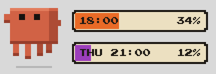

# Claude Usage Widget 2.0 🦀

A tiny native macOS floating widget and menu-bar app for Claude subscription
usage, with Claw'd as an animated pixel-art companion. AppKit only, macOS 13+.
Orange shows 5-hour usage; purple shows weekly usage. Each bar shows percent
**used** and its reset time. Drag the widget to move it; click Claw'd's legs to
minimize it. Right-click the widget or status item for the account menu.



Claw'd cycles through reading, coding, music, photography and cooking, sleeps
22:00–07:00, worries at 70%, panics at 90%, and dances when a limit resets.
Position, minimized state and display preferences survive relaunches.
The app registers itself under System Settings → Login Items.

## Multiple accounts

The local Python server combines two sources:

- **This Mac's Claude Code login**, from the Keychain item
  `Claude Code-credentials`. Its identity comes from the OAuth profile endpoint,
  with `~/.claude.json` as a local fallback. Usage comes from the official
  `/api/oauth/usage` endpoint. The server refreshes expired OAuth credentials and
  saves rotated credentials back to the Keychain.
- **Bridge accounts**, from `~/.config/claude-bridge/accounts/<label>.token`
  (one long-lived `claude setup-token` token per file, mode 600), with a matching
  `<label>.json` containing `email`, `org_uuid` and optional `expires_at`/`plan`.
  Labels listed in `CLAUDE_BRIDGE_ACCOUNTS=pho:/path/pho.token,kkpk:/path/kkpk.token,…`
  in `~/.config/claude-bridge/env` appear first, in that order. Remaining labels
  sort alphabetically. Discovery uses the accounts directory; env paths specify
  the preferred order, not additional token sources.

Matching organization UUIDs merge the Keychain login with its bridge account.
The merged account keeps its label and uses the official endpoint, falling back
to a bridge probe if it fails. An unmatched login appears as **This Mac**;
a signed-out Keychain adds no account. Token files and sidecars are never edited.

Inference-only bridge tokens cannot use the usage/profile endpoints. Instead,
the server sends a minimal Messages request (`max_tokens: 1`) and reads its
unified rate-limit response headers. **A probe consumes about 22 input tokens
and 1 output token, counts toward subscription usage, and can start a 5-hour
window on an idle account.** The default probe model is
`claude-haiku-4-5-20251001`. Header fractions are converted to percent used.
Team accounts with no weekly headers show **–**, never 0%.

The app polls `/api/accounts` every 60 seconds; probes are cached per account
for 600 seconds. Failures retain the last good snapshot labelled **stale**, with
a five-minute backoff. Rejected tokens show **token rejected** and a renewal
hint (`scripts/add-account.sh <label>`, in the bridge tooling). A 429 containing
usage headers still supplies valid data, labelled `rejected` on its windows.
Missing data stays missing; it never becomes a zero.

Server configuration (stdlib Python 3.9+, no packages):

| Variable | Default |
| --- | --- |
| `CLAUDE_USAGE_ACCOUNTS_DIR` | `~/.config/claude-bridge/accounts` |
| `CLAUDE_USAGE_BRIDGE_ENV` | `~/.config/claude-bridge/env` |
| `CLAUDE_USAGE_PROBE_MODEL` | `claude-haiku-4-5-20251001` |
| `CLAUDE_USAGE_PROBE_SECONDS` | `600` (minimum `120` for automatic polling) |

### Account menu and display options

The primary account's full section comes first, marked **PRIMARY**, followed by
the secondary account when selected. Rows show the limit label, percent used,
a thin bar, and reset time. Other accounts stay collapsed into one compact line;
open one for its full rows, **Make Primary** and **Make Secondary**.

- **Primary Account**: radio list of labels and emails. Initially this Mac's
  login, otherwise the first account. **Secondary Account**: None (default), or
  any account except the primary. Choosing the secondary as primary swaps them.
- **Menu Bar → Accounts**: Primary only (default), Primary + Secondary, or
  All Accounts. Multiple gauges get short label tags, expanded to two letters
  when first letters collide.
- **Menu Bar → Style**: Percent (text), Battery (default; capacity left),
  HP Bar (ten pixel segments of capacity left, rounded up), Dual Bars (5-hour
  above weekly, fill shows used), or Ring (outer 5-hour, inner weekly, used).
- **Menu Bar → Metric**: 5-Hour, Weekly, Both, or Most Used (default; the higher
  available percentage). Dual Bars and Ring always show both windows.
- **Show Numbers**: on by default. Numbers describe percent **used** even when
  a battery/HP fill shows capacity **left**. Green means below 70% used, amber
  70–89%, red 90%+. Missing windows show **–**; errors show **!** without fill.
  Spacing shrinks and numbers drop as needed to keep the status image below
  160 points. Percent with numbers hidden gives an icon-only status item.
- **Always Show in Menu Bar**: on by default; turn it off for the old behavior
  where the status item appears only while minimized. Left-click shows the
  widget; right-click or Control-click opens the menu.
- **Widget**: Primary only (default), or Primary + Secondary. The panel grows
  for the second pair of tagged bars. Claw'd's mood follows primary usage;
  reset celebrations and offline state are tracked separately per account.
- **Minimize to Menu Bar / Show Widget**, **Refresh Now**, **Usage Settings…**,
  **Quit Claude Usage**. Refresh Now requests every account via guarded
  `POST /api/refresh?account=<id>`; snapshots younger than 60 seconds and failure
  backoffs are protected from repeated probes.
- **This Mac's Login → Switch Account… / Sign Out** affect only the Keychain
  login. Sign Out asks for confirmation. When signed out, this submenu offers
  **Sign In to Claude…** and starts a visible Claude Code login in Terminal.

Old `barMode` preferences migrate once: Off becomes Percent with numbers hidden;
5-Hour/Weekly/Both becomes the corresponding Metric.

## Install

Requires **macOS 13+** and **Xcode Command Line Tools**
(`xcode-select --install`). Set up bridge token accounts and/or sign in to
[Claude Code](https://claude.com/claude-code).

```bash
git clone https://github.com/applepiece/claude-usage-widget.git
cd claude-usage-widget
./install.sh
```

Uninstall with `./uninstall.sh`.

## Local API and security

The app starts `/usr/bin/python3 server.py` from
`~/Library/Application Support/claude-usage-widget`. The server binds only to
**127.0.0.1:8737**, checks Host on GETs, and requires the existing **X-Widget: 1**
and absent Origin guard for POSTs. Tokens are read only inside the server and
sent only to Anthropic for authentication; they are never logged or returned to
the UI. Bridge tokens remain in their existing protected files. The registry API
returns selected identity fields and parsed usage values, without credentials,
fingerprints, organization headers or arbitrary upstream headers.

`/api/accounts` returns all accounts and states. The legacy `/api/usage`,
`/api/account`, `/api/login`, `/api/logout`, `/api/ping` and HTML page routes retain
their existing behavior. The app uses the single-account API only when an older
server returns 404 for `/api/accounts`.

## Development and offscreen previews

```bash
mkdir -p .build/module-cache
export PYTHONPYCACHEPREFIX="$PWD/.build/pycache"
swiftc -O -module-cache-path .build/module-cache -o .build/ClaudeUsage app/*.swift
/usr/bin/python3 -m unittest discover -s tests -v
python3 -m unittest discover -s tests -v
/usr/bin/python3 -m py_compile server.py
```

Run these previews **outside the sandbox**, on a Mac with WindowServer access.
They render offscreen without showing windows, registering login items or
contacting the server. Output paths below stay in the ignored build directory.

```bash
.build/ClaudeUsage --preview-menu .build/menu.png
.build/ClaudeUsage --preview-menu .build/menu-dark.png --dark
.build/ClaudeUsage --preview-menu .build/menu-signed-out.png --signed-out
.build/ClaudeUsage --preview-statusbar .build/statusbar.png
.build/ClaudeUsage --preview-statusbar .build/statusbar-dark.png --dark
.build/ClaudeUsage --preview-widget .build/widget.png
.build/ClaudeUsage --preview-widget .build/widget-two-dark.png --dark --two
```

Menu samples: pho 15%/82% (machine login), kkpk 0%/37%, mahidol 4%/no weekly.
The status grid covers every style × accounts mode, plus an error account.
All three preview modes support `--dark`; the widget supports `--two` and the
menu supports `--signed-out`. Visual QA is separate from compilation. Generate all ten light/dark previews with
`bash tests/preview_checks.sh` outside the sandbox, then inspect the PNGs in
`.build/previews/` for clipping, contrast and missing-window states.

## สำหรับผู้ใช้ภาษาไทย

เวอร์ชัน 2.0 แสดงการใช้ Claude หลายบัญชี ทั้ง login ของ Claude Code ใน Keychain
และ token จาก `~/.config/claude-bridge/accounts/<label>.token` พร้อมไฟล์ `.json`
ที่ระบุ email และ `org_uuid` เรียงตาม `CLAUDE_BRIDGE_ACCOUNTS` ในไฟล์ bridge `env`
ก่อน แล้วตามตัวอักษร หาก org ตรงกันจะรวมเป็นบัญชีเดียว; login ที่ไม่ตรงแสดงเป็น
This Mac และเมื่อ sign out จะไม่เพิ่มบัญชีจาก Keychain

บัญชี bridge อ่านโควต้าจาก response headers ของ Messages probe เพราะ token
แบบ inference ใช้ usage endpoint ไม่ได้ **แต่ละ probe ใช้ประมาณ 22 input tokens
และ 1 output token นับเป็นการใช้งานจริง และอาจเริ่มรอบ 5 ชั่วโมงของบัญชีที่ว่างอยู่**
เก็บ cache 10 นาทีต่อบัญชี (ตั้ง `CLAUDE_USAGE_PROBE_SECONDS` ได้ ขั้นต่ำ 120 วินาที
สำหรับการตรวจอัตโนมัติ) แอปอ่านข้อมูลทุก 60 วินาที บัญชีที่รวมกับ Keychain ใช้
usage endpoint ก่อนและ probe เมื่อจำเป็น ไม่มีรายสัปดาห์แสดง **–** ไม่ใช่ 0%
เมื่อดึงข้อมูลล้มเหลวแสดง stale และพัก 5 นาที; token ถูกปฏิเสธแสดง token rejected
พร้อมคำแนะนำ `scripts/add-account.sh <label>` ในเมนู

คลิกขวาเพื่อดู **PRIMARY** และ **SECONDARY** พร้อมเปอร์เซ็นต์ แถบ และเวลารีเซ็ต
บัญชีอื่นย่อเหลือบรรทัดเดียว เปิดเมนูย่อยเพื่อดูรายละเอียดหรือเลือก **Make Primary /
Make Secondary** เลือกบัญชีหลักจาก **Primary Account** (เริ่มที่ login ของเครื่อง)
และบัญชีรองจาก **Secondary Account** (เริ่มที่ None)

- **Menu Bar → Accounts**: Primary only / Primary + Secondary / All Accounts
- **Style**: Percent / Battery (ค่าเริ่มต้น) / HP Bar / Dual Bars / Ring
  Battery และ HP แสดงพลังที่เหลือ แต่ตัวเลขแสดงเปอร์เซ็นต์ที่ใช้ไป; Dual และ Ring
  แสดงการใช้ทั้งรอบ 5 ชั่วโมงและรายสัปดาห์เสมอ
- **Metric**: 5-Hour / Weekly / Both / Most Used (ค่าเริ่มต้น เลือกค่าสูงสุด)
- **Show Numbers** เปิดเป็นค่าเริ่มต้น สีเขียวเมื่อใช้ต่ำกว่า 70%, เหลือง 70–89%,
  แดงตั้งแต่ 90%; ข้อมูลหายเป็น **–**, ข้อผิดพลาดเป็น **!** และไม่มีแถบเติม
  ซ่อนตัวเลขอัตโนมัติเมื่อพื้นที่ไม่พอ โหมด Percent ที่ปิดตัวเลขเหลือไอคอนอย่างเดียว
- **Always Show in Menu Bar** เปิดเป็นค่าเริ่มต้น ปิดเพื่อให้แสดงเฉพาะตอนย่อ widget
- **Widget**: Primary only / Primary + Secondary ขยายพื้นที่สำหรับบัญชีรอง
  มีป้ายชื่อย่อ แถบส้ม 5 ชั่วโมง แถบม่วงรายสัปดาห์ น้อง Claw'd เปลี่ยนท่าตามบัญชีหลัก
  และติดตาม offline/การรีเซ็ตแยกตามบัญชี
- **Minimize / Show Widget**, **Refresh Now** (ทุกบัญชี แต่ไม่ probe ซ้ำภายใน
  60 วินาทีหรือระหว่างพักหลังข้อผิดพลาด), **Usage Settings…**, **Quit**
- **This Mac's Login → Switch Account… / Sign Out** เปลี่ยนเฉพาะ login ใน Keychain
  ไม่แก้ token ของบัญชีอื่น; หากยังไม่ login จะมี **Sign In to Claude…**

ลากเพื่อย้ายตำแหน่ง คลิกขาน้องเพื่อย่อ คลิกซ้ายไอคอน menu bar เพื่อเรียกกลับ
คลิกขวาหรือ Control-click เพื่อเปิดเมนู จำการตั้งค่าข้ามการเปิดแอปและเปิดอัตโนมัติ
ตอน login macOS ติดตั้งด้วย `./install.sh` (ต้องมี Xcode Command Line Tools)

ตรวจภาพด้วย `--preview-menu <png> [--dark] [--signed-out]`,
`--preview-statusbar <png> [--dark]`, `--preview-widget <png> [--dark] [--two]`
ตามตัวอย่างด้านบน ต้องรันนอก sandbox บน Mac ที่เข้าถึง WindowServer ได้
โหมด preview ไม่แสดงหน้าต่างและไม่ติดต่อ server

## Credits & license

- Code: [MIT](LICENSE)
- Font: [Press Start 2P](https://fonts.google.com/specimen/Press+Start+2P)
  by CodeMan38, [SIL OFL 1.1](app/fonts/OFL.txt)
- **Claw'd** is Anthropic's Claude Code mascot. This is an unofficial fan-made
  tool, not affiliated with or endorsed by Anthropic.
